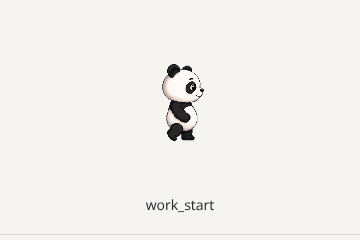
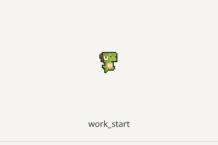

# 实时宠物反应 · 第二阶段

基于 main `a5bc3f1`（v0.4.19），关联 #73 / #128。

## 事件与视觉设计

保留 `MonitorRunner → pet-react → useMonitor → usePetStore → PetRenderer / PetEffects` 链路，复用现有交互计时器和 Sprite / Lottie / Image 播放器。

| 事件         | 触发边界                                      | 旧皮肤表现               | 播放上限 | 独立冷却 |
| ------------ | --------------------------------------------- | ------------------------ | -------- | -------- |
| `work_start` | 活跃 provider 总数从 0 变为 1                 | 轻微抬起、伸展，单颗闪光 | 900 ms   | 15 s     |
| `multi_tool` | 活跃 provider 从不足 2 个变为至少 2 个        | 左右交替弹动，两侧闪光   | 1600 ms  | 30 s     |
| `work_done`  | 最后一个 provider 停止，整段连续活跃至少 30 s | 保留现有 celebrate 庆祝  | 2000 ms  | 120 s    |

- 每轮扫描最多一个事件。0 → 2+ 时直接发出 `multi_tool`，避免同一轮先开工再跳到忙碌。
- 同时活跃持续 2+、从 2 增至 3 或 provider 换名不重复触发；降低到 1 再升到 2 才有新的触发边界。
- Rust 发射层与前端播放层分别保留独立冷却。冷却中的边界直接丢弃，不排队、不在冷却结束后补播；新一轮有效边界才可能触发。
- 初次扫描若已经活跃，也会按 0 → 1 / 2+ 处理。监测仍使用现有 provider 的活跃窗口和扫描频率，并非精确的 prompt / tool-call 事件流。
- 当前并行度是**不同 provider 同时活跃**，不能辨认同一个 provider 内多个子 Agent 或多个工具调用；不把它宣称为子 Agent 级监测。
- `provider` 为稳定排序后的活跃集合首项；结束事件使用停止前的集合。`durationSecs` 表示整段连续活跃的时长，provider 替换或部分停止不重置它。

## 播放与打断

优先级：直接互动（抚摸、戳、社交 wave 等） > `work_done` > `multi_tool` > `work_start` > 原有运动／心情。

更高优先级的事件可替换当前事件；同级或低级事件不能重启当前动画。直接互动随时打断事件，事件不能打断直接互动。开始拖动立即取消事件，拖动期间丢弃事件。所有被忽略的事件都不排队。

事件播放不改写 movement、score、steps 或 mood；结束后恢复**最新**运动／心情，而非播放前的快照。替换时取消旧计时器，store disposal 和粒子组件卸载时清理计时器；切换互动时清除前一组粒子。

`prefers-reduced-motion: reduce` 时 CSS 位移、旋转和粒子运动停用，短暂的静态事件符号仍可表达状态。已有 sprite 的基础运动仍遵循原有播放器行为。

## 皮肤兼容

本阶段没有新增、生成或修改任何 sprite 图片，也没有伪造专属工作帧。14 款内置皮肤通过原有运动帧 + CSS 叠加获得反应，叠加期间不重挂载基础播放器。

`skin.json.animations` 支持三个可选键：`react_start` / `react_multi` / `react_done`。配置结构与已有动画一致；专属动画继续使用该皮肤的 `format`。缺少对应键时保留当前 movement clip，并应用上表的 CSS 回退，不把正在跑动的皮肤切成 idle。

存在专属键时，由同一个现有播放器短暂播放它，不叠加该事件的 CSS 肢体动作；统一计时器到期后恢复运动。作者应将帧数／fps 编排到 900 / 1600 / 2000 ms 的时限内，`loop: false` 可保留末帧直到时限结束。专属动画不会通过 `duration` 延长事件，也不引入新的 fallback 链或必填字段。切换皮肤时重新解析可选键，旧皮肤仍可接续 CSS 回退。

`validate:skins` 已认识三个可选键，仍校验文件和 sprite 必填属性。Rust 导入器原本按动画条目验证文件，能够接受这些可选键，无需更改。

## 交互验证

```sh
pnpm install --frozen-lockfile
pnpm test
pnpm lint:check
pnpm validate:skins
pnpm build
cd packages/app/src-tauri
cargo fmt --check
cargo clippy -- -D warnings
cargo test
```

浏览器验证入口：

```sh
pnpm --dir packages/app dev --host 127.0.0.1
```

打开 http://127.0.0.1:1420/reactions.html 。这是单独的开发入口，不加入正式应用入口或生产构建。仅把 native skin URL 转为开发服务器静态资源，并注入模拟载荷；播放逻辑、状态、皮肤解析和组件都来自生产源码。无新的运行时依赖。

1. 点击“播放完整流程”，依次观察开工、双工具、完成、回到 idle。
2. 在 run 状态触发事件，结束后仍为 run；连续点击同事件不重启。
3. 在 multi_tool 播放中点击“抚摸打断”，再点 work_done，后者被忽略，结束后没有补播。
4. 触发事件后勾选“模拟拖动”，事件立即结束；拖动中不接受事件。
5. 切换 Panda、Vita 或其他皮肤，分别在浅色、深色背景观察。重播完整流程前可点“重置冷却”。
6. 系统或浏览器开启减少动态效果设置后，检查位移停止而事件符号仍短暂出现。





## 已验证的范围与限制

- 前端 Vitest：182 项通过，包含事件映射、异常载荷、冷却边界、优先级、计时器、皮肤解析、渲染组件、粒子和事件桥监听测试。
- 皮肤验证 CLI：4 项原生 Node 测试通过，14 款实际内置皮肤校验通过。
- TypeScript、ESLint、前端生产构建通过。
- Rust：直接编译本次 `monitor/react.rs` 源文件的独立测试 harness，8 项测试与 `clippy --all-targets -- -D warnings` 通过；仓库 `cargo fmt --check` 通过。
- Chromium 实际组件验证：14 款皮肤绘制非透明像素、两种不同动作、基础 canvas 持续挂载、手动打断、拖动取消、减少动态效果、320 px 布局、深色背景通过，页面错误与资源失败均为 0，见 [browser-checks.json](reactions/browser-checks.json)。GIF 是该开发入口的实际截图序列，不是概念渲染。
- 当前执行环境缺少完整 Tauri 的 GTK / WebKit 开发依赖，因此完整桌面 crate 的本地 test / clippy 尚未完成。原有 CI 仍运行它们；未把模块 harness 等同于完整桌面验证。
- 尚未运行真实桌面窗口＋本机 Agent 的端到端录屏；模拟桥与 Rust 状态转换分别有自动化覆盖。正式发布前需在支持的桌面环境验证扫描时序、系统窗口边界与真实 Agent 活动。
